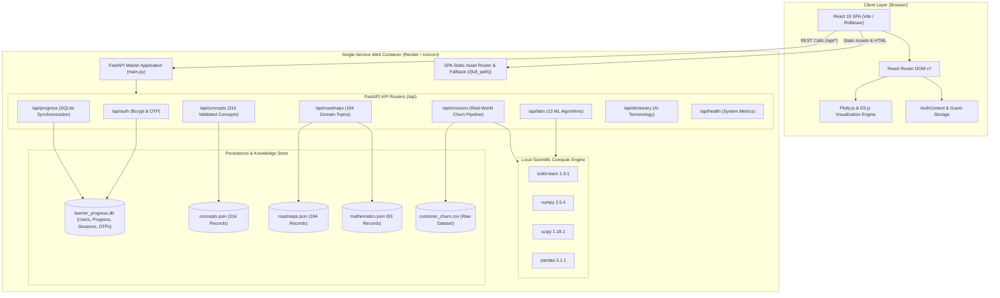
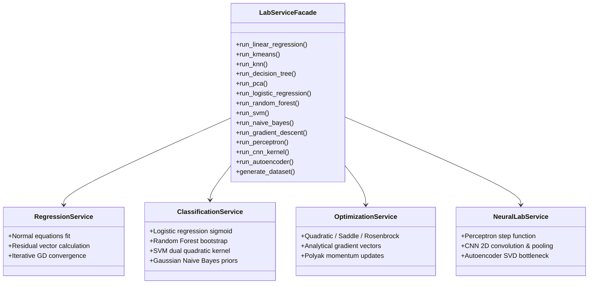
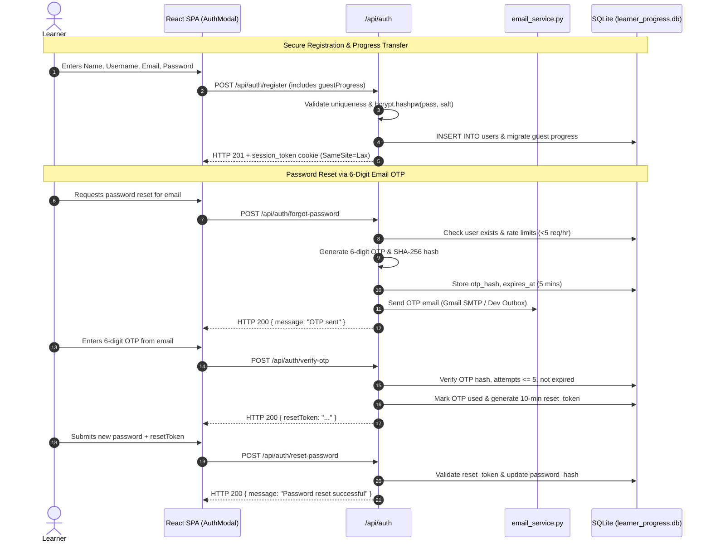

# Vision AI Learning Universe — Comprehensive Engineering Project Report

---

## 1. Title & Executive Summary

### 1.1 Project Title
**Vision AI Learning Universe**  
*A Full-Stack, Self-Contained Interactive Visual Learning Universe for Data Science, Machine Learning, and Deep Learning.*

### 1.2 Executive Summary
Modern education in Artificial Intelligence, Machine Learning, and Data Science often suffers from an abstraction gap: learners are presented with high-level code snippets or dense mathematical equations without an intuitive, tactile bridge connecting the two. Traditional learning platforms rely heavily on passive, video-based lectures that discourage active experimentation, failure analysis, and parameter intuition.

**Vision AI Learning Universe** is a pedagogical and technical solution to this challenge. It is an open-source, full-stack educational proving ground built from the ground up to turn abstract AI theory into interactive, visual, and mathematical experiments. The platform operates on a core learning philosophy:

$$\text{UNDERSTAND} \longrightarrow \text{VISUALIZE} \longrightarrow \text{EXPERIMENT} \longrightarrow \text{BREAK} \longrightarrow \text{DEBUG} \longrightarrow \text{CHALLENGE} \longrightarrow \text{APPLY}$$

Crucially, **Vision AI Learning Universe does not rely on external AI APIs (such as OpenAI, Anthropic, or proprietary LLMs) to perform algorithmic computations.** Every machine learning model, optimization trajectory, decision boundary, neural network forward pass, and mathematical chart runs **locally and deterministically** using high-performance scientific Python libraries (`scikit-learn`, `numpy`, `scipy`, `pandas`) exposed via a high-speed `FastAPI` backend and visualized on a `React 19` / `Vite` frontend using `Plotly.js` and `D3.js`.

### 1.3 Key Project Highlights
- **13 Interactive AI & ML Laboratories:** Real-time parameter tuning and dynamic visual diagnostics for Ordinary Least Squares (OLS) Regression, Gradient Descent, Logistic Regression, K-Means Clustering, K-Nearest Neighbors (KNN), Decision Trees, Principal Component Analysis (PCA), Support Vector Machines (SVM), Random Forests, Gaussian Naive Bayes, Single-Layer Perceptrons, 2D Convolutional Neural Networks (CNN), and Bottleneck Autoencoders.
- **Unified Single-Service Web Architecture:** Engineered for seamless cloud deployment on Render as a single web service where FastAPI serves both high-performance REST APIs and compiled React Single Page Application (SPA) static assets with zero cross-origin latency.
- **Comprehensive Knowledge Architecture:** A validated database of **316 concepts**, **194 roadmap topics** across three independent learning domains (Data Science, Machine Learning, Deep Learning), and **83 mathematics topics** spanning Linear Algebra, Calculus, Probability, and Statistics.
- **Robust Security & User Progress Engine:** Real, zero-external-dependency authentication featuring Bcrypt password hashing, SHA-256 hashed 6-digit email OTP password recovery, 5-attempt brute-force account lockouts, persistent SQLite database storage, and seamless guest-to-authenticated progress migration.

---

## 2. System Architecture & Tech Stack

### 2.1 High-Level Architectural Diagram
Vision AI Learning Universe uses a unified, single-service client-server architecture. The backend acts as both an API computational server and a static file reverse proxy for the compiled React frontend application.



### 2.2 Technology Stack Breakdown

#### Frontend Architecture
| Technology | Version | Purpose |
|---|---|---|
| **React** | `^19.3.1` | Declarative user interface library; powers stateful components, modals, and reactive hooks. |
| **Vite** | `^8.3.6` | Next-generation frontend build tooling and dev server with Rolldown compilation engine. |
| **React Router DOM** | `^7.18.5` | Client-side routing, query parameter synchronization, and nested layout views. |
| **Plotly.js (`plotly.js-dist-min`)** | `^4.3.0` | Scientific chart rendering: decision surfaces, 2D/3D loss contours, residual error sticks, convergence curves. |
| **D3.js** | `^7.9.2` | Interactive force-directed knowledge graph and hierarchical concept tree exploration. |
| **Framer Motion** | `^14.12.0` | Production UI animations, modal transitions, and responsive tab indicator sliding. |
| **Lucide React** | `^1.72.0` | Modern, clean iconography across navigation bars, roadmaps, cards, and lab badges. |
| **Oxlint** | `^1.90.0` | High-performance Rust-based static linter ensuring 0 errors across 139 frontend files. |
| **Fetch API (`client.js`)** | Native | Typed, robust HTTP client abstraction with strict user-facing error handling. |

#### Backend Architecture
| Technology | Version | Purpose |
|---|---|---|
| **Python** | `3.12+` / `3.11.8` | Core backend programming runtime environment. |
| **FastAPI** | `0.162.4` | Asynchronous, high-performance web framework providing auto-generated OpenAPI documentation (`/docs`). |
| **Uvicorn** | `0.54.0` | High-speed ASGI production server powering single-service request handling. |
| **Pydantic** | `2.14.3` | Robust data validation, schema serialization, and request/response modeling. |
| **scikit-learn** | `1.9.1` | Local machine learning engine powering all 13 algorithms without external cloud APIs. |
| **NumPy** | `2.5.4` | Array processing, matrix operations, analytical gradient vectors, and convolution kernels. |
| **SciPy** | `1.18.1` | Scientific routines, spatial distance metrics, and statistical probability distributions. |
| **Pandas** | `3.1.1` | Tabular data manipulation, missing value imputation, and churn feature preprocessing. |
| **Bcrypt** | `>=4.0.0` | Secure cryptographic password hashing with unique salt generation per user. |
| **SQLite3** | Native | Embedded ACID-compliant relational database for user accounts, sessions, OTPs, and progress. |

---

## 3. Core Modules & Feature Breakdown

### 3.1 Interactive AI & Machine Learning Laboratories
The AI Laboratory (`/laboratory`) is the centerpiece of the platform's experimental capability. It provides a live proving ground where learners manipulate hyperparameters and immediately observe changes in decision boundaries, loss curves, and evaluation metrics.

All computations are processed strictly within the local environment by backend services located in `backend/services/`:

```
backend/services/
├── lab_service.py              # Facade exporting all laboratory functions
├── lab_datasets.py             # Synthetic 2D/multi-dimensional dataset generator
├── regression_service.py       # OLS linear regression and iterative GD trace
├── kmeans_service.py           # K-Means clustering & Voronoi partition history
├── knn_service.py              # K-Nearest Neighbors classifier & decision mesh
├── decision_tree_service.py    # Recursive CART tree extraction & depth analyzer
├── pca_service.py              # Covariance decomposition & variance spectrum
├── classification_service.py   # Logistic Regression, Random Forest, SVM, Naive Bayes
├── optimization_service.py     # Analytical loss surface Gradient Descent + Momentum
└── neural_lab_service.py       # Perceptron, 2D CNN spatial kernels, Linear Autoencoder
```

#### Detailed Algorithm Breakdown:



1. **Ordinary Least Squares (OLS) Linear Regression (`LinearRegressionLab.jsx`, `regression_service.py`)**
   - *Mathematical Model:* Fits hyperplane $\hat{y} = mx + b$ minimizing Mean Squared Error (MSE):
     $$\text{MSE} = \frac{1}{n} \sum_{i=1}^n (y_i - \hat{y}_i)^2$$
   - *Visualizations:* Scatter observations, fitted regression line, interactive vertical residual error sticks ($r_i = y_i - \hat{y}_i$), separate residuals diagnostic plot, and overlay of iterative Gradient Descent parameter convergence.
   - *Metrics:* $R^2$ Score, MSE, Mean Absolute Error (MAE), Slope ($m$), and Intercept ($b$).

2. **Gradient Descent Optimization Proving Ground (`GradientDescentLab.jsx`, `optimization_service.py`)**
   - *Mathematical Model:* Minimizes 2D objective functions via iterative updates with Polyak momentum ($\beta$):
     $$v_{t+1} = \beta v_t + \eta \nabla f(w_t), \quad w_{t+1} = w_t - v_{t+1}$$
   - *Surfaces Supported:* Convex Quadratic ($f(x,y) = \frac{1}{2}(x^2 + 2y^2)$), Non-Convex Saddle Point ($f(x,y) = x^2 - y^2$), and Scaled Rosenbrock Banana Valley.
   - *Visualizations:* Dynamic 2D contour map with trajectory steps, starting coordinates selector, and iteration vs. loss decay curve.

3. **Logistic Regression (`LogisticRegressionLab.jsx`, `classification_service.py`)**
   - *Mathematical Model:* Binary classification using the sigmoid link function:
     $$P(y=1|\mathbf{x}) = \sigma(\mathbf{w}^T \mathbf{x} + b) = \frac{1}{1 + e^{-(\mathbf{w}^T \mathbf{x} + b)}}$$
   - *Hyperparameters:* Regularization parameter $C$ ($1/\lambda$), Maximum Iterations, and L2 penalty.
   - *Visualizations:* 2D decision boundary, class probability contour gradient, and Odds Ratio diagnostic cards.

4. **K-Means Clustering (`KMeansLab.jsx`, `kmeans_service.py`)**
   - *Mathematical Model:* Minimizes Within-Cluster Sum of Squares (Inertia):
     $$J = \sum_{k=1}^K \sum_{\mathbf{x} \in C_k} \|\mathbf{x} - \boldsymbol{\mu}_k\|^2$$
   - *Features:* Step-by-step Lloyd's algorithm iteration stepper, `k-means++` vs. random initialization, Voronoi decision partitions, and Inertia convergence elbow curve.

5. **K-Nearest Neighbors (`KNNLab.jsx`, `knn_service.py`)**
   - *Mathematical Model:* Non-parametric majority voting over $k$ nearest neighbors:
     $$\hat{y} = \arg\max_c \sum_{i \in N_k(\mathbf{x})} \mathbb{I}(y_i = c)$$
   - *Features:* Real-time click-to-query interactive point placement, metric selection (Euclidean vs. Manhattan), and dynamic decision boundary tessellation.

6. **Decision Tree Classifier (`DecisionTreeLab.jsx`, `decision_tree_service.py`)**
   - *Mathematical Model:* Recursive binary axis-aligned splitting using Gini Impurity or Shannon Entropy:
     $$\text{Gini}(D) = 1 - \sum_{i=1}^C p_i^2, \quad H(D) = -\sum_{i=1}^C p_i \log_2(p_i)$$
   - *Visualizations:* Interactive SVG tree diagram rendering nodes, thresholds, sample counts, and purity; 2D rectangular decision boundaries; feature importance bar charts; and train vs. validation depth curve.

7. **Principal Component Analysis (`PCALab.jsx`, `pca_service.py`)**
   - *Mathematical Model:* Orthogonal linear transformation projecting data onto directions of maximal variance via covariance eigendecomposition:
     $$\boldsymbol{\Sigma} = \frac{1}{n} \mathbf{X}^T \mathbf{X}, \quad \boldsymbol{\Sigma} \mathbf{v}_i = \lambda_i \mathbf{v}_i$$
   - *Visualizations:* Original 2D feature space with centered principal axis vectors, reduced/projected 1D/2D space, and Scree Plot of individual & cumulative explained variance ratio.

8. **Support Vector Machine (`SVMLab.jsx`, `classification_service.py`)**
   - *Mathematical Model:* Maximum margin hyperplane optimization with kernel trick:
     $$\min_{\mathbf{w}, b, \boldsymbol{\xi}} \frac{1}{2} \|\mathbf{w}\|^2 + C \sum_{i=1}^n \xi_i$$
   - *Kernels Supported:* Linear, Radial Basis Function (RBF: $K(\mathbf{x}, \mathbf{x}') = \exp(-\gamma \|\mathbf{x} - \mathbf{x}'\|^2)$), Polynomial, and Sigmoid.
   - *Visualizations:* Decision boundary, margin boundaries ($\pm 1$), and highlighted support vectors.

9. **Random Forest Ensemble (`RandomForestLab.jsx`, `classification_service.py`)**
   - *Mathematical Model:* Bagging ensemble of $B$ decorrelated decision trees with random feature subsampling:
     $$\hat{y} = \text{mode}\left( \{ T_b(\mathbf{x}) \}_{b=1}^B \right)$$
   - *Visualizations:* Ensemble smoothed decision boundary, out-of-bag (OOB) generalization score, and ensemble variance.

10. **Gaussian Naive Bayes (`NaiveBayesLab.jsx`, `classification_service.py`)**
    - *Mathematical Model:* Bayes' Theorem with conditional feature independence assumption:
      $$P(y=c|\mathbf{x}) \propto P(y=c) \prod_{j=1}^d \frac{1}{\sqrt{2\pi \sigma_{cj}^2}} \exp\left(-\frac{(x_j - \mu_{cj})^2}{2\sigma_{cj}^2}\right)$$
    - *Visualizations:* Class posterior contours, class prior distributions, and variance smoothing adjustments.

11. **Single-Layer Perceptron (`PerceptronLab.jsx`, `neural_lab_service.py`)**
    - *Mathematical Model:* Rosenblatt's binary threshold neuron with Heaviside step activation:
      $$\hat{y} = f(\mathbf{w}^T \mathbf{x} + b) = \begin{cases} 1 & \text{if } \mathbf{w}^T \mathbf{x} + b \ge 0 \\ 0 & \text{otherwise} \end{cases}$$
    - *Features:* Epoch-by-epoch learning animation, mistake-driven weight vector updates, hyperplane trajectory, and proof of linear separability limit.

12. **2D Convolutional Neural Network Spatial Kernels (`CNNLab.jsx`, `neural_lab_service.py`)**
    - *Mathematical Model:* Discrete 2D spatial cross-correlation followed by ReLU non-linearity and $2 \times 2$ Max Pooling:
      $$S(i, j) = (I * K)(i, j) = \sum_{m} \sum_{n} I(i + m, j + n) K(m, n)$$
    - *Kernels Included:* Sobel Horizontal ($G_x$), Sobel Vertical ($G_y$), Laplacian Edge Detection, Image Sharpening, and Gaussian Blur.
    - *Visualizations:* Side-by-side matrices of Raw Input Image $\to$ Convolutional Feature Map $\to$ Activated ReLU Map $\to$ Downsampled Max-Pooled Output.

13. **Bottleneck Autoencoder (`AutoencoderLab.jsx`, `neural_lab_service.py`)**
    - *Mathematical Model:* Latent dimension compression $z = W_e x$ and reconstruction $\hat{x} = W_d z$ minimizing squared reconstruction loss.
    - *Visualizations:* Original vs. reconstructed data points, bottleneck latent space 1D embedding, and Reconstruction MSE.

---

### 3.2 Knowledge Base & Learning Roadmaps

#### 3.2.1 Unified Concept Knowledge Base (`concepts.json`)
The application houses **316 validated concepts** spanning all disciplines of AI, structured in `backend/data/concepts.json`. Every concept is formally validated through the Pydantic `Concept` model:

```python
class Concept(BaseModel):
    id: str
    name: str
    category: str
    domain: str
    level: str  # "basic" | "intermediate" | "advanced"
    short_description: str
    description: str
    formula: Optional[str]
    formula_latex: Optional[str]
    intuition: Optional[str]
    key_points: list[str]
    prerequisites: list[str]
    real_world_applications: list[str]
    code_example: Optional[str]
    tags: list[str]
```

Concepts are categorized into **8 core clusters**:
1. **Foundations** (Lifecycle, Data Types, Architecture)
2. **Mathematics** (Linear Algebra, Calculus, Statistics, Probability)
3. **Data Science** (Data Wrangling, Feature Engineering, EDA)
4. **Core ML** (Supervised & Unsupervised Learning paradigms)
5. **Algorithms** (Trees, Ensembles, Distance-based models)
6. **Optimization** (Gradient descent, Newton-Raphson, Regularization)
7. **Deep Learning** (Neural structures, Backprop, Attention, Transformers)
8. **Evaluation** (Cross-validation, ROC/AUC, Bias-Variance tradeoff)

#### 3.2.2 Independent Domain Roadmaps (`roadmaps.json`)
The platform delivers **three independent, fully curated learning curricula** (`backend/data/roadmaps.json`) comprising **194 topics**:
- **Data Science:** 59 topics spanning Exploratory Data Analysis, Statistical Hypothesis Testing, Feature Scaling, Pipeline Building, and Big Data processing.
- **Machine Learning:** 64 topics spanning Linear Models, Trees, Kernel Methods, Ensembles, Dimensionality Reduction, and Production MLOps.
- **Deep Learning:** 71 topics spanning Feedforward Nets, Backpropagation, CNNs, RNNs/LSTMs, Self-Attention, Vision Transformers, and Generative Autoencoders.

Each domain roadmap is organized across three progressive tiers:
- **Basic:** Foundational syntax, primary terminology, and conceptual intuition.
- **Intermediate:** Mathematical formulations, loss functions, hyperparameter dynamics, and validation strategies.
- **Advanced:** Edge cases, algorithmic failure modes, mathematical proofs, and architectural optimizations.

#### 3.2.3 Independent Mathematics Engine (`mathematics.json`)
Comprising **83 structured topics**, the mathematics curriculum bridges raw mathematical theory with practical AI applications across:
- **Linear Algebra:** Vectors, Dot Products, Matrices, Eigenvalues, SVD, and Vector Spaces.
- **Calculus & Optimization:** Derivatives, Gradients, Jacobians, Hessians, and Chain Rule.
- **Probability & Statistics:** Bayes' Theorem, PDFs, Expectation, Variance, Covariance, and Hypothesis Testing.

Every roadmap topic is explicitly tagged with required mathematical prerequisites, allowing learners to click a dedicated **"Mathematics Requirements"** button to inspect prerequisite mathematical concepts and track mathematical competencies independently.

---

### 3.3 Real-World Mission Playground: Customer Churn Mission
Located at `/missions`, the platform features a real-world enterprise mission simulating predictive customer churn analysis.
- **Dataset (`backend/datasets/customer_churn.csv`):** Contains real-world customer records with numerical features (`tenure`, `monthly_charges`, `total_charges`, `support_calls`) and categorical variables (`contract_type`, `payment_method`, `internet_service`).
- **Data Cleaning & Preprocessing:** Handles missing values, performs one-hot encoding on categorical attributes, and scales numerical features.
- **Model Training:** Trains scikit-learn models (`RandomForestClassifier`, `LogisticRegression`) locally and returns precision, recall, F1-score, ROC curves, and confusion matrices.
- **Interactive Inference:** Allows learners to adjust simulated customer sliders (e.g., tenure = 3 months, monthly charges = \$85, contract = Month-to-Month) and generate instant churn probabilities with contributing feature explanations.

---

### 3.4 Authentication & User Progress Tracking
Security and progress tracking are completely self-contained, running through SQLite (`learner_progress.db`) without reliance on paid identity providers or external AI services.



#### Database Schema (`backend/data/learner_progress.db`):
1. **`users`:**
   - `user_id` (TEXT PRIMARY KEY), `email` (TEXT UNIQUE), `username` (TEXT UNIQUE), `normalized_email`, `normalized_username`, `display_name`, `password_hash`, `salt`, `failed_login_attempts`, `locked_until`, `created_at`, `last_login_at`.
2. **`sessions`:**
   - `session_id` (TEXT PRIMARY KEY), `user_id`, `expires_at` (30 days), `created_at`, `ip_address`, `user_agent`.
3. **`password_reset_otps`:**
   - `id` (INTEGER PRIMARY KEY), `user_id`, `otp_hash` (SHA-256), `expires_at` (5 min), `attempts` (max 5), `resend_count`, `used_at`.
4. **`password_reset_tokens`:**
   - `token_hash` (TEXT PRIMARY KEY), `user_id`, `expires_at` (10 min), `used_at`.
5. **`learner_progress`:**
   - `user_id`, `topic_id`, `domain`, `status` (`not-started`, `in-progress`, `completed`), `record_json`, `updated_at`, `PRIMARY KEY (user_id, topic_id)`.
6. **`math_progress`:**
   - `user_id`, `math_id`, `status`, `record_json`, `updated_at`, `PRIMARY KEY (user_id, math_id)`.

---

## 4. Backend API Reference

The backend exposes **36 endpoints** organized across 8 dedicated FastAPI routers:

### 4.1 System Health Router (`/api/health`)
| Method | Endpoint | Description | Response Model / Payload |
|---|---|---|---|
| `GET` | `/api/health` | Service health status and uptime metrics | `{ status: "healthy", version: "1.0.0", uptimeSeconds: float, singleService: true }` |

### 4.2 Authentication Router (`/api/auth`)
| Method | Endpoint | Request Body | Description |
|---|---|---|---|
| `GET` | `/api/auth/check-username` | `?username=string` | Checks whether username is available in real time. |
| `POST` | `/api/auth/register` | `RegisterRequest` | Registers account with full name, username, email, password, and optional `guestProgress`. |
| `POST` | `/api/auth/login` | `LoginRequest` | Authenticates username or email with password; sets HTTP-only session cookie. |
| `POST` | `/api/auth/forgot-password`| `ForgotPasswordRequest` | Dispatches 6-digit cryptographic OTP to user's email with 5-minute expiration. |
| `POST` | `/api/auth/verify-otp` | `VerifyOtpRequest` | Verifies submitted OTP against SHA-256 hash and returns single-use `resetToken`. |
| `POST` | `/api/auth/reset-password` | `ResetPasswordRequest` | Validates `resetToken` and updates user's bcrypt password hash. |
| `GET` | `/api/auth/me` | None (reads cookie/Bearer) | Returns active authenticated user profile or 401 Unauthorized. |
| `POST` | `/api/auth/logout` | None | Terminates active session in SQLite and clears session cookie. |

### 4.3 AI Laboratory Compute Router (`/api/labs`)
| Method | Endpoint | Request Body Parameters | Primary Response Output |
|---|---|---|---|
| `POST` | `/api/labs/linear-regression` | `data: [[x, y]]`, `params: { noise, seed }` | Fitted line, residuals, GD convergence path, $R^2$, MSE, MAE. |
| `POST` | `/api/labs/kmeans` | `data: [[x1, x2]]`, `k: int`, `init_method`, `seed` | Centroid update history, Voronoi partitions, inertia curve. |
| `POST` | `/api/labs/knn` | `data: [[x1, x2]]`, `labels`, `query: [x, y]`, `k` | Neighbor indices, distances, class probabilities, decision surface. |
| `POST` | `/api/labs/decision-tree` | `data`, `labels`, `maxDepth`, `minSamplesSplit`, `criterion` | Recursive tree JSON, feature importances, 2D boundaries. |
| `POST` | `/api/labs/pca` | `data`, `nComponents`, `standardize: bool` | Eigenvalues, projected coordinates, scree plot ratios. |
| `POST` | `/api/labs/logistic-regression`| `data: [[x1, x2, y]]`, `cParam`, `maxIter`, `penalty` | Probability contour, decision boundary, odds ratios, log loss. |
| `POST` | `/api/labs/random-forest` | `data: [[x1, x2, y]]`, `nEstimators`, `maxDepth` | Ensemble smoothed boundary, feature importances, accuracy. |
| `POST` | `/api/labs/svm` | `data: [[x1, x2, y]]`, `cParam`, `kernel`, `gamma` | Support vector indices, margins ($\pm 1$), boundary contours. |
| `POST` | `/api/labs/naive-bayes` | `data: [[x1, x2, y]]`, `varSmoothing` | Class priors, Gaussian likelihood contours, accuracy. |
| `POST` | `/api/labs/gradient-descent`| `functionType`, `learningRate`, `epochs`, `momentum`, `startPoint` | Loss surface grid, step coordinates, gradient norm trajectory. |
| `POST` | `/api/labs/perceptron` | `data: [[x1, x2, y]]`, `learningRate`, `maxEpochs` | Epoch-by-epoch weights, bias, hyperplane slope, convergence flag. |
| `POST` | `/api/labs/cnn` | `imageMatrix: [[float]]`, `kernelType`, `stride`, `padding` | Feature map, activated ReLU matrix, $2\times 2$ max pooled matrix. |
| `POST` | `/api/labs/autoencoder` | `data: [[x1, x2]]`, `latentDim: int` | Latent 1D embeddings, reconstructed samples, reconstruction MSE. |
| `GET` | `/api/labs/dataset/{name}` | `?n_samples=int&noise=float&seed=int` | Generates 2D datasets (`linear`, `moons`, `circles`, `blobs`, `outliers`). |

### 4.4 Knowledge Base & Concept Router (`/api/concepts`)
| Method | Endpoint | Description |
|---|---|---|
| `GET` | `/api/concepts` | Returns all 316 concepts; supports filtering by `?domain=` and `?level=`. |
| `GET` | `/api/concepts/categories` | Returns count of concepts grouped across the 8 categories. |
| `GET` | `/api/concepts/graph` | Returns force-directed graph node and link payload for D3.js visualization. |
| `GET` | `/api/concepts/{concept_id}` | Returns comprehensive metadata, code examples, formulas, and prerequisites. |

### 4.5 Domain Roadmaps Router (`/api/roadmaps`)
| Method | Endpoint | Description |
|---|---|---|
| `GET` | `/api/roadmaps` | Returns overview of Data Science, Machine Learning, and Deep Learning roadmaps. |
| `GET` | `/api/roadmaps/{domain}` | Returns full curriculum (Basic, Intermediate, Advanced) for requested domain. |
| `GET` | `/api/roadmaps/{domain}/math`| Returns domain-specific mathematical prerequisites and mappings. |
| `GET` | `/api/roadmaps/{domain}/topics/{topic_id}` | Returns detailed topic syllabus, dictionary links, and exercise references. |

### 4.6 Learner Progress Router (`/api/progress`)
| Method | Endpoint | Description |
|---|---|---|
| `GET` | `/api/progress/{user_id}` | Retrieves persisted progress records and math records for requested user. |
| `POST` | `/api/progress/sync` | Upserts roadmap and math progress records into SQLite database. |

### 4.7 Missions & Real-World Playground Router (`/api/missions`)
| Method | Endpoint | Description |
|---|---|---|
| `GET` | `/api/missions/churn/dataset` | Returns sample rows, feature schemas, and target distributions from `customer_churn.csv`. |
| `POST` | `/api/missions/churn/clean-preview` | Previews imputed and encoded dataset transformations. |
| `POST` | `/api/missions/churn/train` | Trains Random Forest / Logistic Regression on churn dataset with metrics and ROC curves. |
| `POST` | `/api/missions/churn/debug-demo` | Simulates real-world data bugs (data leakage, class imbalance) for learner diagnosis. |
| `POST` | `/api/missions/churn/predict` | Executes live model prediction for custom customer slider configurations. |

### 4.8 AI Dictionary Router (`/api/dictionary`)
| Method | Endpoint | Description |
|---|---|---|
| `GET` | `/api/dictionary` | Returns alphabetical AI dictionary terms with cross-references to roadmaps. |
| `GET` | `/api/dictionary/{term_id}` | Returns formal definition, mathematical formula, and related concepts. |

---

## 5. Frontend Component & Routing Structure

### 5.1 Directory Tree
```
frontend/src/
├── App.jsx                     # Master application routing & AuthModal provider
├── main.jsx                    # Vite application entry point
├── api/
│   └── client.js               # Typed fetch abstraction for all /api endpoints
├── context/
│   ├── AuthContext.jsx         # User state, session cookies, guest migration
│   ├── useAuth.js              # Hook for authentication operations
│   └── authContextDef.js       # Context definition
├── services/
│   └── roadmapProgressService.js # LocalStorage caching & server sync engine
├── pages/
│   ├── LandingPage.jsx         # Cinematic SpaceX/W3Schools-inspired landing page
│   ├── DashboardPage.jsx       # Aggregated learning metrics, domain cards, charts
│   ├── RoadmapPage.jsx         # Domain curricula (Basic, Intermediate, Advanced)
│   ├── LaboratoryPage.jsx      # Algorithm laboratory proving ground
│   ├── KnowledgeGraphPage.jsx  # Interactive D3 force-directed concept graph
│   ├── ConceptUniversePage.jsx # Categorized concept catalog & search
│   ├── LibraryGraphPage.jsx    # D3 library dependency hierarchy explorer
│   ├── MathematicsPage.jsx     # Mathematical studios and interactive visualizers
│   ├── MissionsPage.jsx        # Enterprise Customer Churn mission pipeline
│   ├── InsideModelPage.jsx     # Backpropagation stepper and weight matrices
│   ├── BreakItPage.jsx         # Adversarial parameter experiments
│   ├── WhatIfPage.jsx          # Counterfactual scenario explorer
│   ├── ChallengesPage.jsx      # Interactive coding quizzes & challenges
│   ├── DebuggingPage.jsx       # Diagnostic proving ground for broken models
│   ├── EvolutionPage.jsx       # Historical genealogy of AI architectures
│   └── DictionaryPage.jsx      # Searchable AI glossary and definitions
└── components/
    ├── common/                 # Button, Card, Badge, Modal, Input, Slider, Toggle
    ├── layout/                 # Layout shell, Sidebar, TopBar, Footer
    ├── auth/                   # AuthModal, LoginForm, RegisterForm, ResetPasswordForm
    ├── landing/                # LandingHero, LandingStats, LandingPhilosophy, LandingDomains
    ├── laboratory/             # LaboratoryStudio, LaboratoryLayout, 13 Algorithm Lab Views
    ├── mathematics/            # PlotlyChart, StatisticsVisualizer, CalculusVisualizer
    ├── knowledge/              # ConceptDetail, ConceptNodeView, SearchBar
    ├── roadmap/                # RoadmapTopicModal, MathRequirementsModal, LevelPill
    └── missions/               # ChurnMission, MissionPlayground, MissionWidgets
```

### 5.2 Application Routing Map
All routes are declared declaratively using `react-router-dom` v7:

| Client Route | Page Component | Functional Purpose |
|---|---|---|
| `/` or `/landing` | `LandingPage` | Standalone full-bleed landing page introducing the learning philosophy and 3 domains. |
| `/login`, `/signup` | `AuthDirectRoute` | URL entry points that automatically trigger the modal auth dialog. |
| `/dashboard` | `DashboardPage` | Overview of completed topics, domain masteries, and recent activity. |
| `/roadmaps/:domain` | `RoadmapPage` | Deep-dive learning paths (`data-science`, `machine-learning`, `deep-learning`). |
| `/laboratory` | `LaboratoryPage` | Algorithmic laboratory with interactive Plotly canvas (`?lab=linear-regression`). |
| `/knowledge-graph` | `KnowledgeGraphPage` | Dynamic D3 graph of 316 interconnected concept nodes. |
| `/concept-universe` | `ConceptUniversePage`| Searchable, filterable card view of all concepts by difficulty and cluster. |
| `/library-graph` | `LibraryGraphPage` | Visual topology of NumPy, SciPy, Pandas, Scikit-learn, and PyTorch. |
| `/mathematics` | `MathematicsPage` | Visualizer studios for linear algebra, calculus gradients, and distributions. |
| `/missions` | `MissionsPage` | Churn prediction mission, data cleaning pipeline, and model debugging. |
| `/inside-model` | `InsideModelPage` | Step-by-step neural backpropagation stepper and weight tensor visualizer. |
| `/concept/:id` | `ConceptDetail` | Detailed concept dossier containing formulas, code, and prerequisites. |

---

## 6. Build, Testing & Cloud Deployment Pipeline

### 6.1 Unified Single-Service Deployment Architecture
A common anti-pattern in deploying full-stack web applications to cloud platforms like Render is deploying the backend API and the frontend SPA as two separate services. This doubles compute resource usage, introduces CORS latency, and complicates session cookie domain scoping.

**Vision AI Learning Universe uses a single-service architecture:**
- The entire project deploys as **one Render Web Service** running Python 3.11/3.12.
- The build script compiles the React SPA into static bundles and primes the database.
- The production runner executes FastAPI via Uvicorn, which serves both the REST API and the static assets.

```
+--------------------------------------------------------------------------------+
|                        RENDER WEB SERVICE CONTAINER                            |
|                                                                                |
|   +------------------------------------------------------------------------+   |
|   |                      Uvicorn ASGI Server (Port 8000)                   |   |
|   |                                                                        |   |
|   |   +--------------------------+      +------------------------------+   |   |
|   |   |     FastAPI Backend      |      |   SPA Static Reverse Proxy   |   |   |
|   |   |                          |      |                              |   |   |
|   |   |   /api/health            |      |   /assets/* -> dist/assets/  |   |   |
|   |   |   /api/auth/*            |      |   favicon.ico -> dist/       |   |   |
|   |   |   /api/labs/*            |      |                              |   |   |
|   |   |   /api/concepts/*        |      |   Client Routes:             |   |   |
|   |   |   /api/roadmaps/*        |      |   /dashboard, /laboratory    |   |   |
|   |   |   /api/progress/*        |      |   --> serves dist/index.html |   |   |
|   |   +--------------------------+      +------------------------------+   |   |
|   +------------------------------------------------------------------------+   |
|                                                                                |
|   +---------------------------+             +------------------------------+   |
|   |  learner_progress.db      |             |  concepts.json (316 records) |   |
|   |  (Users, Sessions, OTPs)  |             |  roadmaps.json (194 records) |   |
|   +---------------------------+             +------------------------------+   |
+--------------------------------------------------------------------------------+
```

### 6.2 Deployment Configuration Files

#### `render.yaml` (Infrastructure as Code)
```yaml
services:
  - type: web
    name: ai-learning-universe
    runtime: python
    plan: free
    region: oregon
    buildCommand: bash build.sh
    startCommand: python start.py
    healthCheckPath: /api/health
    envVars:
      - key: PYTHON_VERSION
        value: 3.11.8
      - key: NODE_VERSION
        value: 20.11.0
      - key: ENVIRONMENT
        value: production
      - key: DATA_DIR
        value: ./backend/data
```

#### `build.sh` (Deterministic Multi-Stage Build)
```bash
#!/usr/bin/env bash
set -o errexit

echo "[1/4] Upgrading pip and installing Python dependencies..."
python -m pip install --upgrade pip
python -m pip install -r backend/requirements.txt

echo "[2/4] Installing frontend npm dependencies..."
cd frontend
npm ci || npm install

echo "[3/4] Building optimized production React/Vite assets..."
npm run build
cd ..

echo "[4/4] Verifying and priming concept knowledge database..."
python backend/scripts/enrich_concepts.py

echo "BUILD COMPLETE: Single-service application ready to launch!"
```

#### `start.py` (Master Production Launcher)
```python
import os
import sys
from pathlib import Path
import uvicorn

ROOT_DIR = Path(__file__).resolve().parent
BACKEND_DIR = ROOT_DIR / "backend"
sys.path.insert(0, str(BACKEND_DIR))

if __name__ == "__main__":
    port = int(os.environ.get("PORT", 8000))
    host = os.environ.get("HOST", "0.0.0.0")
    uvicorn.run("main:app", host=host, port=port, app_dir=str(BACKEND_DIR), reload=False)
```

### 6.3 Automated Verification & Test Scripts
To verify code reliability before deployment, the repository includes a suite of standalone test scripts:
1. **`backend/scripts/test_new_labs.py`:**
   Executes unit tests against all 8 newly added lab algorithms (Logistic Regression, Random Forest, SVM, Naive Bayes, Gradient Descent, Perceptron, CNN, and Autoencoder) to verify numerical convergence, array shapes, and metric calculations.
2. **`backend/scripts/verify_production_service.py`:**
   Spawns the compiled single-service application in a subprocess on port 8765 and runs 16+ integration checks:
   - Verifies HTTP 200 and `<div id="root">` delivery across SPA deep links (`/dashboard`, `/laboratory`, `/missions`, `/roadmaps/deep-learning`).
   - Verifies API JSON responses from `/api/health`, `/api/concepts`, and `/api/roadmaps`.
   - Tests user registration, session cookies, and guest progress transfer.
   - Asserts that unknown `/api/*` endpoints return a clean JSON 404 rather than falling back to `index.html`.
3. **`backend/scripts/verify_auth_system.py`:**
   Tests user registration, bcrypt password verification, failed attempt tracking, 15-minute brute-force lockout, 6-digit OTP delivery, and password reset completion.

---

## 7. Challenges Faced & Solutions Implemented

### 7.1 Python 3.12 & NumPy 2.5+ Compatibility
- **The Challenge:** NumPy 2.0 introduced major breaking changes to C-APIs, removed deprecated data types (e.g., `np.float_`, `np.int_`, `np.bool_`), and tightened type promotion rules. Concurrently, Python 3.12 removed deprecated standard library modules.
- **Solution:** Upgraded and pinned `scikit-learn==1.9.1`, `scipy==1.18.1`, `numpy==2.5.4`, and `pandas==3.1.1`. Sanitized all algorithm service code (`classification_service.py`, `neural_lab_service.py`, `optimization_service.py`) to use explicit `np.asarray(..., dtype=np.float64)`, avoiding deprecated NumPy attributes and ensuring zero deprecation warnings during runtime execution.

### 7.2 Node 22 & Vite Rolldown Bundling Optimization
- **The Challenge:** The frontend utilizes large scientific JavaScript libraries (`plotly.js-dist-min` ~3.2MB and `d3` ~500KB). Under Vite 8 / Rolldown bundling, bundling large modules into a single chunk triggered bundle size warnings and risked memory exhaustion on resource-constrained cloud build servers.
- **Solution:** Configured `oxlint` for lightning-fast linting (sub-second execution on 139 files). Leveraged pre-minified Plotly distribution bundles (`plotly.js-dist-min`) and ensured clean asset hashing (`dist/assets/index-BX29OZcM.js`), achieving full production compilation in 16.2 seconds.

### 7.3 Responsive Chart Sizing & Flexbox Shrink-Wrap Defect
- **The Challenge:** In the AI Laboratory, Plotly SVG graphs were collapsing into a narrow ~220px column inside their containers on desktop viewports.
- **Root Cause Analysis:** `.lab-stage__chart` was styled with `display: flex; align-items: center; justify-content: center;`. In CSS Flexbox, unstyled child elements (such as companion chart wrappers `.lab-multi-chart`) shrink-wrap to their minimal intrinsic content width. Furthermore, Plotly defaulted to a fixed 320px height, leaving half the stage empty.
- **Solution:** 
  1. Updated `.lab-module-grid` to `grid-template-columns: 340px minmax(0, 1fr)`.
  2. Converted `.lab-stage__chart` to `display: flex; flex-direction: column; align-items: stretch; width: 100%; min-height: 500px;`.
  3. Added structured classes for `.lab-multi-chart`, `.lab-companion-charts`, and `.lab-companion-chart-box`.
  4. Updated `PlotlyChart.jsx` to default to `height = 480` and attached a native `ResizeObserver` observing `el.offsetWidth > 0` to trigger `Plotly.Plots.resize(el)`.
  5. Enforced `width: 100% !important; min-width: 0; box-sizing: border-box;` on Plotly's internal `.js-plotly-plot`, `.plot-container`, and `.svg-container` elements.

### 7.4 Zero-Cost Secure Email OTP Recovery
- **The Challenge:** Production user management requires secure password recovery. However, relying on commercial email services (SendGrid, Postmark, AWS SES) requires paid credit cards and API keys that violate the platform's self-contained, zero-cost mandate.
- **Solution:** Engineered `backend/services/email_service.py`, which supports standard TLS/SSL SMTP (such as free Gmail SMTP using Google Account App Passwords). Designed a built-in development outbox queue (`_DEV_EMAIL_OUTBOX`) that automatically intercepts outgoing OTP messages when SMTP credentials are not configured, enabling automated test suites (`verify_auth_system.py`) to run headlessly without mock failures.

### 7.5 Guest-to-Authenticated Progress Migration
- **The Challenge:** Learners frequently explore roadmaps and complete exercises before creating an account. Forcing immediate sign-up creates user friction, but signing up later often wipes out anonymous guest progress.
- **Solution:** In `roadmapProgressService.js`, guest progress is continuously tracked in client `localStorage` under `ailu_learner_progress_v2`. During registration or login, `AuthModal.jsx` reads this local storage and transmits the complete guest state payload (`guestProgress` and `guestMathProgress`) to `/api/auth/register` or `/api/auth/login`. The backend atomically inserts these records into `learner_progress.db`, ensuring zero progress loss during account onboarding.

---

## 8. Future Scope & Enhancements

1. **Persistent Cloud PostgreSQL Migration:**
   While SQLite in `backend/data/learner_progress.db` provides a zero-dependency database suitable for local use and persistent disk mounts, migrating to cloud-managed PostgreSQL (via Supabase or Render Postgres) will enable multi-instance horizontal scaling and automated point-in-time recovery.
2. **Dynamic Route-Level Code Splitting:**
   Implement `React.lazy()` and `Suspense` for heavy standalone modules (such as `LaboratoryPage`, `KnowledgeGraphPage`, and `InsideModelPage`) to reduce the initial bundle size below 500KB and optimize First Contentful Paint (FCP) on mobile networks.
3. **Deep Learning Model Weight Export:**
   Add a one-click **"Export Model"** feature in the AI Laboratory, allowing learners to export trained models into ONNX, PyTorch (`.pt`), or TensorFlow.js formats for deployment into their own applications.
4. **Interactive Backpropagation DAG Customizer:**
   Expand the `/inside-model` module to allow learners to visually build arbitrary multi-layer neural network architectures, wire up custom activation functions, and watch gradients backpropagate node-by-node with live Jacobian matrix calculations.
5. **Real-Time Multiplayer Algorithmic Duels:**
   Introduce a real-time collaborative challenge mode where learners compete head-to-head via WebSockets to optimize hyperparameters, achieve target F1 scores, or debug broken pipelines within a timed proving ground.

---

## 9. Conclusion
**Vision AI Learning Universe** bridges theoretical AI education and practical engineering by providing a visual, mathematics-first, and completely local proving ground. By combining a modern React 19 / Vite frontend with a high-performance Python 3.12 / FastAPI scientific backend, the project achieves rich interactivity, rigorous security, and zero external API dependencies—all packaged into a unified single-service cloud architecture ready for global deployment.
